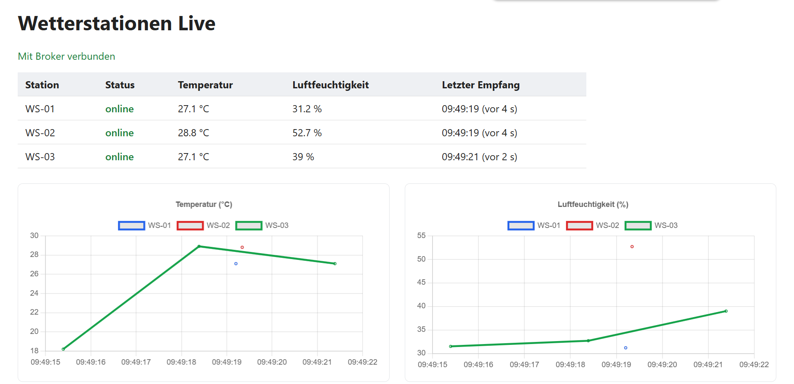
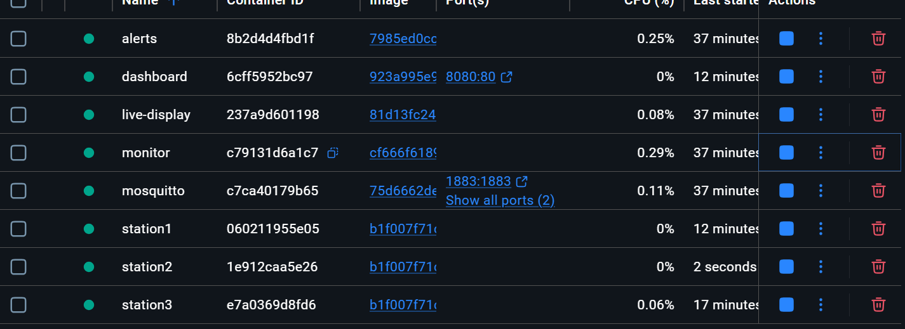

# MQTT Wetterstationen mit Terraform

Drei Wetterstationen senden Messwerte über MQTT an Mosquitto. Live-Display, Monitor, Alerts und Dashboard verarbeiten die Daten. Früher lief alles mit Docker Compose, jetzt mit Terraform (Provider `kreuzwerker/docker`), jeder Service in einem eigenen Container.

## Befehle

Starten:

```
docker compose down
terraform init
terraform plan
terraform apply
```

Dashboard: http://localhost:8080

Löschen:

```
terraform destroy
```

## Umsetzung

- `main.tf`: Netzwerk, Volume, Images und Container
- `variables.tf`: Stationen, Intervalle, Ports, Grenzwerte
- `outputs.tf`: Dashboard-URL und Containerliste

Die Images werden aus meinen Dockerfiles gebaut, die drei Stationen kommen mit `for_each` aus dem gleichen Image. Alle Container sind im Netzwerk `weather-net`, der Broker heisst dort `mosquitto`. Mosquitto hat einen Healthcheck, die anderen Container starten erst, wenn er healthy ist. Die Alert-Logs liegen im Volume `weather-alerts-logs`. Das Live-Display habe ich früher von Hand gestartet, jetzt hat es ein Dockerfile und läuft auch als Container.

Das Dashboard baue ich mit `local-exec` und `docker build`, weil der Build über den Provider bei mir bei `npm ci` hängen geblieben ist.

## 1 Terraform initialisieren

Nach `terraform init` gab es den Ordner `.terraform/` mit dem heruntergeladenen Docker-Provider und die Datei `.terraform.lock.hcl`, in der die genaue Provider-Version mit Prüfsummen steht. Nach `terraform apply` kamen `terraform.tfstate` und `terraform.tfstate.backup` dazu. Darin merkt sich Terraform, welche Ressourcen es erstellt hat.

Ins Git kommen die `.tf`-Dateien und die `.terraform.lock.hcl`, damit alle die gleiche Provider-Version haben. In die `.gitignore` kommen `.terraform/` (gross und mit `terraform init` neu ladbar) und die State-Dateien (lokal, können sensible Daten enthalten). Den State behalte ich lokal, sonst kann Terraform die Container nicht mehr verwalten.

## 2 Anwendung bereitstellen

`terraform plan` hat `Plan: 16 to add, 0 to change, 0 to destroy.` gezeigt: 6 Images, 8 Container, 1 Netzwerk und 1 Volume. Danach habe ich alles mit `terraform apply` gestartet.





## 3 Infrastrukturänderung

Ohne Änderung hat `terraform plan` `No changes.` gezeigt.

Danach habe ich in `variables.tf` das Intervall von `station2` von 7 auf 10 geändert.

Erwartung: Nur `station2` ist betroffen. Weil man die Umgebungsvariablen eines laufenden Containers nicht ändern kann, wird er ersetzt.

```
  # docker_container.station["station2"] must be replaced
-/+ resource "docker_container" "station" {
      ~ env                                         = [ # forces replacement
          - "INTERVAL=7",
          + "INTERVAL=10",
            # (2 unchanged elements hidden)
        ]
        name                                        = "station2"
        ...
    }

Plan: 1 to add, 0 to change, 1 to destroy.
```

Terraform löscht den Container `station2` und erstellt ihn neu, geändert oder gelöscht wird sonst nichts. Das entspricht meiner Erwartung. Die anderen Zeilen mit `(known after apply)` kommen nur daher, dass der Container neu erstellt wird.

Nach `terraform apply` sendet `station2` alle 10 Sekunden (geprüft mit `docker logs -f station2`).
